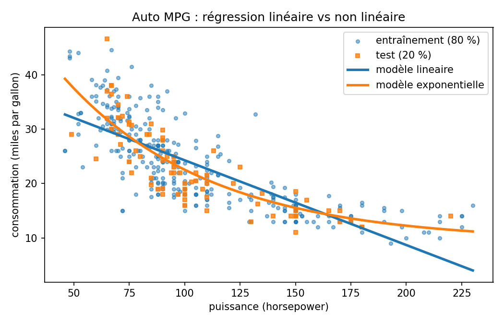
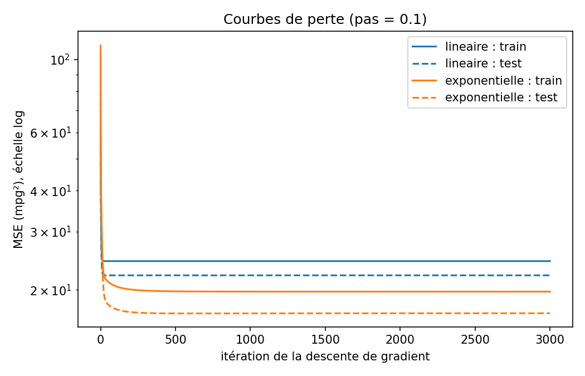
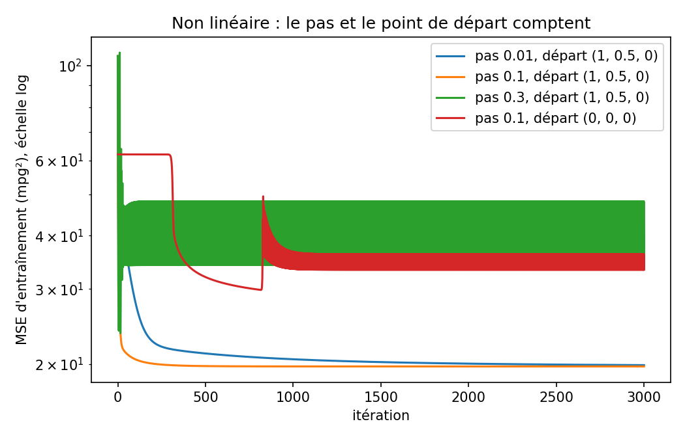

# Étape A : régression linéaire et non linéaire

Projet : IA pour le débruitage de matrices de rotation (PBI T-EC-01)
Équipe : Hamesa Belgherras, Axel Heuclin, Arthur Ritz, Jean Baptiste Truffier
Baseline : `v0.1`
Date : 9 novembre 2026

## 1. Objectif

Recoder une régression sans bibliothèque d'apprentissage (numpy uniquement, gradient calculé à la main), d'abord linéaire puis non linéaire, sur des données réelles. C'est la préparation demandée en réunion du 30 octobre : une optimisation itérative écrite à la main est le même mécanisme que celui qui servira ensuite sur SO(3) et dans le réseau de neurones.

## 2. Données

Jeu Auto MPG (UCI) : 398 voitures. On prédit la consommation `mpg` (miles par gallon) à partir de la puissance `horsepower`.

| Étape de nettoyage | Lignes restantes |
|---|---|
| Fichier brut | 398 |
| Suppression des puissances manquantes (`?`) | 392 |
| Suppression des doublons | 392 |
| Valeurs plausibles (mpg > 0, puissance > 0) | 392 |

Découpage 80 % entraînement / 20 % test, graine 42. x et y sont centrés-réduits avec les statistiques du jeu d'entraînement seulement (pas de fuite de données).

## 3. Méthode

Une régression = un modèle f(x ; θ), une perte (erreur quadratique moyenne), un optimiseur (descente de gradient θ ← θ − η ∇L(θ), η = 0,1, 3 000 itérations). L'optimiseur est commun aux deux modèles.

| Modèle | Équation | Linéaire en θ ? |
|---|---|---|
| Linéaire | y = w x + b | Oui : solution exacte connue (équations normales) |
| Exponentiel | y = a e^(−b x) + c | Non : b est dans l'exponentielle, il faut itérer |

Les gradients écrits à la main sont vérifiés par différences finies (gradient check, `tests/test_regression.py`).

## 4. Résultats (jeu de test, 79 voitures)

| Modèle | MSE (mpg²) | RMSE (mpg) | R² |
|---|---|---|---|
| Linéaire | 22,11 | 4,70 | 0,60 |
| Exponentiel | 16,96 | 4,12 | 0,70 |

- La descente de gradient linéaire retrouve la solution exacte des moindres carrés à 10⁻⁶ près.
- Le modèle exponentiel réduit l'erreur quadratique d'environ 23 %. La droite prédit des consommations absurdes (environ 4 mpg) pour les fortes puissances ; la courbe se stabilise vers 11 mpg.
- La MSE de test est plus faible que celle d'entraînement : c'est un effet du tirage du découpage, pas un défaut du modèle.

## 5. Leçons sur l'optimisation non linéaire

1. **Mise à l'échelle** : sans standardiser y, la descente diverge (valeurs NaN), car le gradient en b contient le facteur a·x·e^(−bx).
2. **Pas** : η = 0,3 fait osciller la perte sans converger ; η = 0,01 converge mais lentement.
3. **Initialisation** : en partant de θ = (0, 0, 0), le gradient en b est nul (df/db = −a x e^(−bx) avec a = 0). La descente reste sur un plateau puis aboutit à une moins bonne solution. En non linéaire, le point de départ compte.

## 6. Lien avec la suite

Sur SO(3), seul le pas change : R ← R · Exp(−η · grad) au lieu de θ ← θ − η · grad, ce qui garantit que R reste une rotation à chaque itération. Prochaine étape : estimer une rotation à partir de mesures bruitées par descente de gradient sur SO(3) (moyenne de Fréchet, étape D).
